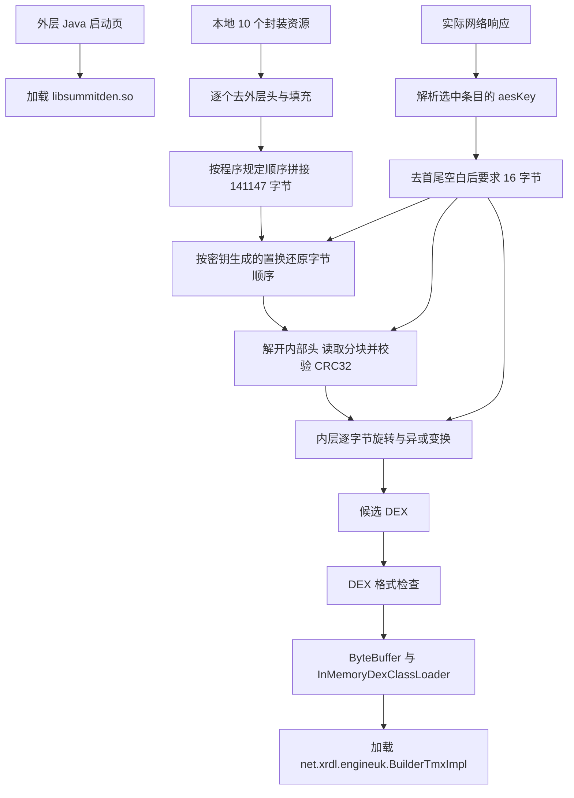

# Spark 最终业务 DEX：本轮离线恢复记录

日期：2026-10-24。目标：Spark Slide Nest 2.0，包名 `com.tjwqxmzplk.sparkslidenest`。

**已经恢复载荷组装与解码算法，尚未取得通过校验的最终业务 DEX。** 本轮没有运行 APK、访问样本后台或调整设备地区条件。Unicorn 只仿真了若干独立原生子函数，输入均为合成数据，不是运行完整应用。

## 直接看哪些文件

| 文件 | 能看什么 |
|---|---|
| [recover_business.py](recover_business.py) | 根据样本原生代码重写的可读离线解码器；不是作者原始源码 |
| [reference-native/](reference-native/) | 相关 Ghidra 伪代码，保留函数地址和原有平坦化流程 |
| [carrier-manifest.json](carrier-manifest.json) | 10 个原始资源的实际顺序、封装头、跳过长度、拼接偏移及散列 |
| [assembled-permuted.bin](assembled-permuted.bin) | 已去除外层包装并按程序顺序拼接的 141,147 字节载荷；仍不是 DEX |
| [native-equivalence-check.json](native-equivalence-check.json) | 15 项独立原生函数与 Python 结果的合成输入对照 |
| [candidate-scan.json](candidate-scan.json) | 包内 1,597 个恰好 16 字节、无空格的可见 ASCII 字符串候选，均未通过封装头校验 |
| [evidence/rea-native-load-entry.json](evidence/rea-native-load-entry.json) | 本轮 REA/JADX 对加载原生库入口的实际方法证据 |
| [verify_native.py](verify_native.py) | 对照所用 ARM64 子函数仿真脚本；含受限内存分配与复制接口 |

## USB 手机连接是不是必需

**不是绝对必需。当前缺少的是对应载荷的实际解码参数或已经恢复的模块，而不是 USB 本身。**

| 已有输入或环境 | 是否必须通过 USB | 能继续做什么 |
|---|---|---|
| 只有现有安装包 | 否 | 分析全部已存放的 DEX/SO，提取资源，恢复解码算法；本轮已继续做这些工作 |
| 已有加载后的真实 DEX | 否 | 验证 DEX 头、SHA-1、Adler-32、结构与类清单，再用 JADX 阅读 |
| 已有与该版本载荷对应的实际 16 字节参数 | 否 | 用离线解码器处理本地载荷，再验证结果；现在没有该实际值 |
| 已有应用授权导出的有效缓存或运行记录 | 否 | 先判断其中是否真的含模块/参数；文件名带 cache 不能证明含这些数据 |
| 可以运行目标版本的受控 Android 环境 | 不一定；可以是合适的实体机或模拟器 | 在具备必要权限的情况下观察已加载模块；未证明任意模拟器都兼容此样本 |
| 手机只有普通 USB 调试权限 | 连接本身不充分 | 发布版 App 的私有存储和进程内存未必可读，不能保证直接取出 DEX |

本轮 `adb devices -l` 没有列出连接设备；用户随后选择继续离线整理。没有把“当前缺少运行材料”写成“任何离线办法都不可能”。

## 实际加载架构



图中的响应解析和加载关系来自静态代码；本轮未观察到实际响应，也没有输出图中最终候选 DEX。网页模块入口类名来自本地原生库，不表示已恢复该类的方法体。

## 每个步骤的具体代码位置

地址为 Ghidra 显示地址；该数据库加了 `0x100000` 基址，原始 ELF VA 需减去此值。读取文件字节时仍需根据 PT_LOAD 映射换算文件偏移，不能直接拿地址当文件偏移。

| 步骤 | 原生伪代码文件 | 可读解码器对应位置 |
|---|---|---|
| 列出 10 个资源及业务入口类 | [00180458.c](reference-native/00180458.c) | `ORDER` |
| 去除每个资源的外层头与填充 | [00152344.c](reference-native/00152344.c) | `prepare` |
| 拼接后依次进行三段变换 | [001493c8.c](reference-native/001493c8.c) | `decode` |
| 使用 FNV-1a 64 位散列生成置换 | [0015450c.c](reference-native/0015450c.c)、[00154d84.c](reference-native/00154d84.c) | `permutation`、`fnv64` |
| 按置换恢复字节位置 | [001525b4.c](reference-native/001525b4.c) | `unshuffle` |
| 解开 12 字节内部头 | [0015623c.c](reference-native/0015623c.c) | `header` |
| 跳过内部填充、依次取分块 | [001527d8.c](reference-native/001527d8.c) | `blocks` |
| CRC32 损坏检查 | [001564c0.c](reference-native/001564c0.c) | `zlib.crc32` 对照原函数结果 |
| 内层字节恢复 | [00153188.c](reference-native/00153188.c)、[00156ff0.c](reference-native/00156ff0.c) | `inner_decode` |
| 检查 DEX 特征后装入内存类加载器 | [00149b68.c](reference-native/00149b68.c)、[00149d44.c](reference-native/00149d44.c) | `dex_validation` 是分析端更严格的验收，不等于 App 原检查 |

### 外层资源并不是普通配置

每份资源头包含 4 字节标识、版本以及偏移 6 处的 16 位填充长度。原函数检查版本 2，然后从 `8 + padding` 开始取实际数据。10 份有效部分按 `ORDER` 顺序连接，本轮得到：

- 长度：`141147` 字节。
- SHA-256：`fe5fc8e5608412857443a81d34c2c812deb47d672dcf9874fa3f7049a876f037`。
- 原始 APK 与已导出的资源目录两种输入重建结果完全相同。

`RES0`、`RCAC`、`PAKF` 是这里看到的外层标识；不能把 `RCAC` 或扩展名 `.cache` 当成已经存在运行缓存的证据。

### 内部变换做了什么

第一段根据 16 字节参数的 FNV-1a 64 位散列和 xorshift64* 序列生成 Fisher–Yates 置换。恢复方向是 `output[permutation[i]] = input[i]`，不是再执行一次同方向打乱。代码见 `permutation` 与 `unshuffle`。

第二段使用输入前 4 字节和参数散列生成 12 字节掩码，恢复版本、填充长度、预期输出大小及 CRC。之后跳过填充，循环读取 16 位分块长度和相应数据。原实现允许零长度块，仍会消费其长度字段；离线解码器已按这个行为修正。最终对恢复的分块结果计算 CRC32，不一致则失败。CRC 是损坏检查，不能当作服务端身份认证。

第三段处理带或不带额外 4 字节标识的内层数据，从其中取种子，再结合参数、数据长度、伪随机序列和按位旋转恢复输出字节。本轮能给这些算法具体名称，是因为已读相应运算并做原函数对照；**字段名叫 aesKey 并不能证明这三段使用 AES**。

### 为什么找不到一个可以直接打开的业务 DEX

响应参数经过解析与去首尾空白处理后，沿 `00144594 → 00146914 → 001493c8` 传入上述变换；长度必须为 16 字节。响应取值代码见 [00144958.c](reference-native/00144958.c)，不是本轮拿到了实际参数值。

恢复结果随后被复制到 Java 字节数组，再通过 `ByteBuffer.wrap` 交给 `InMemoryDexClassLoader`。这条路径可直接在内存中加载模块，不要求先在磁盘保存独立 `.dex`。因此普通文件管理器、普通 USB 连接，甚至单纯开启 ADB，都不保证能找到最终文件。

## 本轮验证与明确边界

1. 按程序顺序提取 10 份载荷，记录原始与派生散列；由公开阅读目录中的资源重建得到同一字节串。
2. 完成离线解码器；使用原 SO 的 ARM64 子函数对照 FNV、伪随机序列、头掩码、三个长度的逆置换、有效封装、空分块、CRC 损坏拒绝，以及两种内层头，共 **15 项全部通过**。独立函数仿真只提供合成输入下的算法证据，未证明真实载荷解码成功。
3. 有界扫描 APK 成员及现有原生明文/XOR-aa 字符串清单内完整的 16 字节、无空格的可见 ASCII 字符串（0x21–0x7e），共 1,597 个不同候选；全部在内部头版本/边界检查处失败，没有有效 DEX。扫描没有覆盖任意编码、所有派生方式、非 ASCII、含空格或远程值，不能据此证明其都不存在。
4. 当前没有实际对应参数、加载后的 DEX、进程转储或被证实有用的缓存；最终业务类方法体仍未知。
5. 解码器验收标准 DEX 的头、声明大小、主要表边界、SHA-1 和 Adler-32；只支持其写明的标准 112 字节头格式。这些检查不等于完整 ART/DEX 结构验证，得到文件后仍须进一步解析。它没有把不合格数据改名成 `.dex`，也没有把核心包源码拿来代替 Spark 恢复结果。

## REA 与其他工具各自完成什么

本轮 REA/JADX 实际确认 `NestLobbyActivity.onCreate$lambda$3` 调用 `System.loadLibrary("summitden")`，Evidence ID：`ev_4d6cb1e73d45f479c9d614353c6bf303b068890167c992aa666a2c34652889b5`。

尝试 REA 原生函数分析时，其 Windows Ghidra 提供器报告只接受 PE，拒绝了 ARM64 ELF；尝试检查拼接载荷时，REA 报告不支持该自定义格式。这两次属于诊断，见 `evidence/rea-permutation-function-2026-10-24.json` 与 `evidence/rea-assembled-carrier.json`，不能称作成功的原生反编译或成功识别 DEX。

因此这轮原生算法继续基于已有独立 Ghidra 伪代码与原始库，并用 Unicorn 独立子函数仿真交叉核对。REA、Ghidra 和 Unicorn 的产出各自保留，没有混称。

## 怎样离线使用这些材料

只阅读代码与 JSON 不需要安装环境。`recover_business.py` 的 `prepare/decode` 只依赖 Python 标准库，可在 Spark 阅读目录中使用：

```text
python recovery/recover_business.py prepare --sample-root . --output-dir recovery-local
```

这里的 `.` 指当前 Spark 目录；请在对应目录执行。它读取既有 `java/outer/resources/assets`，派生文件写入自选新目录。也支持原分析布局的 `apks/base.apk`。`scan` 为复现本轮完整 APK 成员搜索，需要原始 base.apk 及两份原生字符串清单。

后续若在授权范围内已有匹配的实际参数文件，可用 `decode --key-file <本地文件>`；文件必须恰好 16 原始字节，脚本不会打印其内容。当前材料不包含该实际值。得到匹配参数只是允许验证本地载荷，不代表一定恢复成功；须以 DEX 校验和后续解析结果为准。

`verify_native.py` 需要 `requirements-verification.txt` 列出的 Unicorn 与 pyelftools，默认优先加载脚本旁 `deps/`。仿真只映射原库和自建的内存/栈，导入接口限制在分配、释放、复制、比较等操作；未调用 APK 的 JNI 入口。依赖目录与实际参数文件不属于公开材料。

完整恢复的下一步取决于新增输入：匹配参数或真实加载后模块到手后，先验证、再反编译和更新类清单。目前保留“未取得最终业务 DEX”，原因和已完成工作如上，不能用这句话替代本轮进度。
